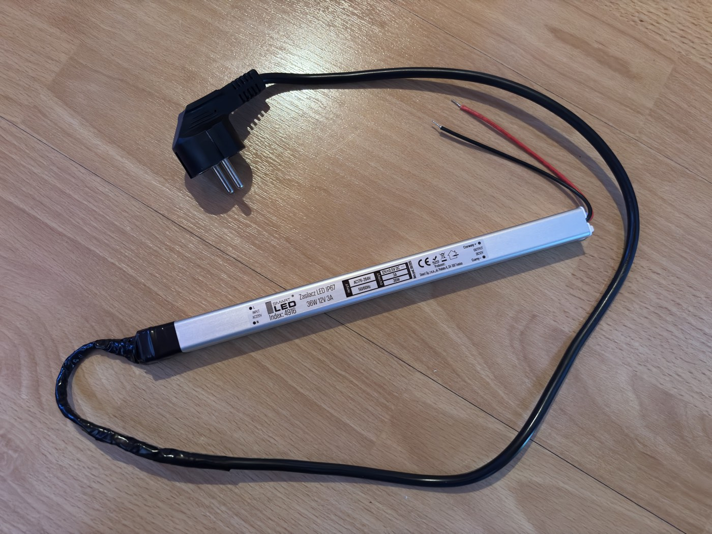

# Build journal

Chronological log of physical build progress. Photos live in `media/`,
resized to a max dimension of ~1400px and compressed to keep each file
under ~350KB.

## 2026-07-16 - Power cable prep

Prepared the 20m power cable for the gate run: cut to length, soldered to
the PSU input leads with heat-shrink tubing, verified phase vs. neutral
before connecting, sealed the splice tightly with insulating tape.

**Next:** start testing RFID (MFRC522) on branch `test/rfid-read`.
